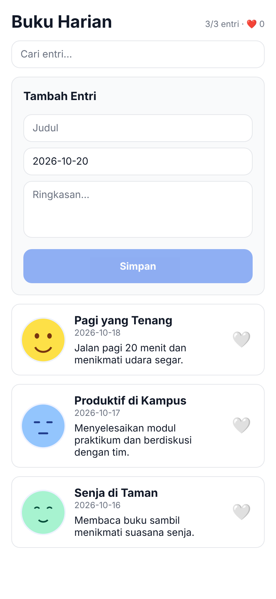
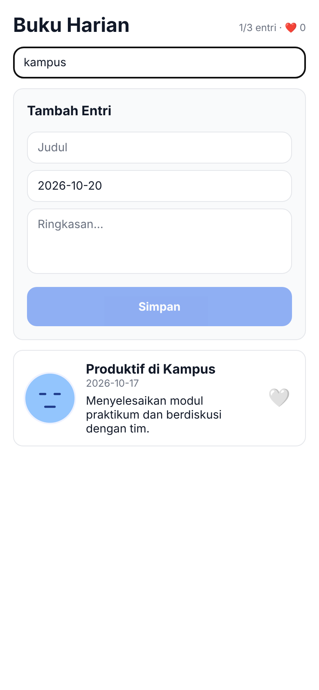
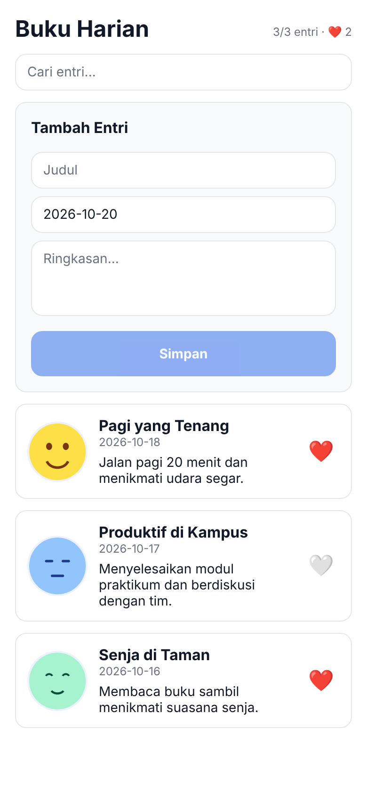
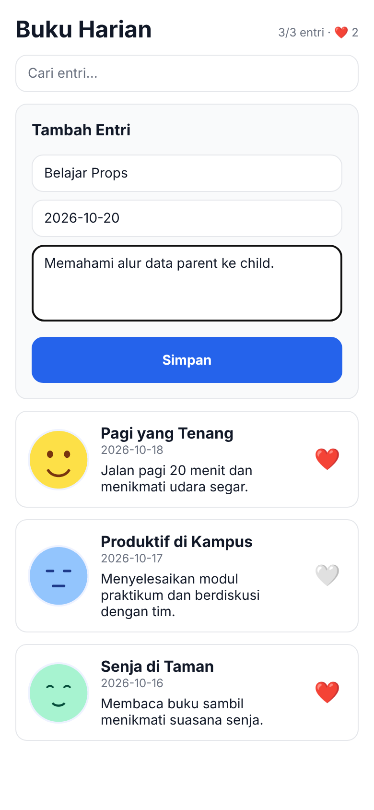
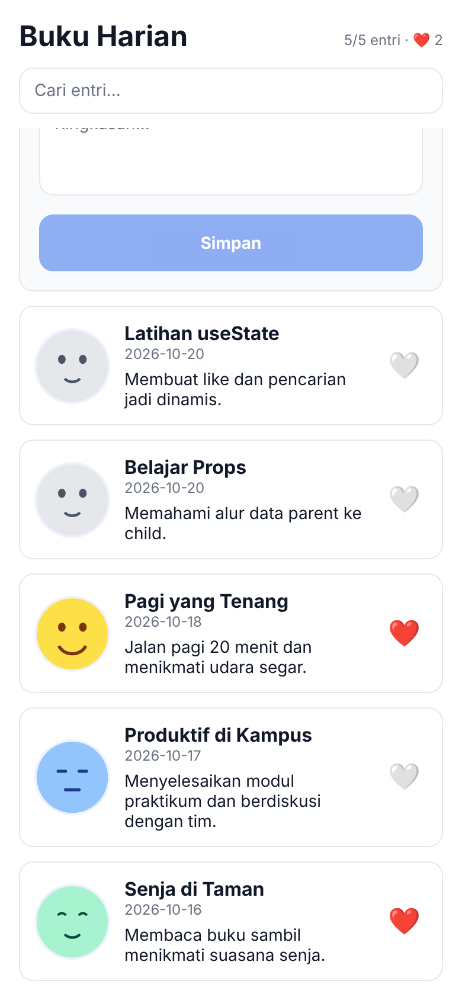
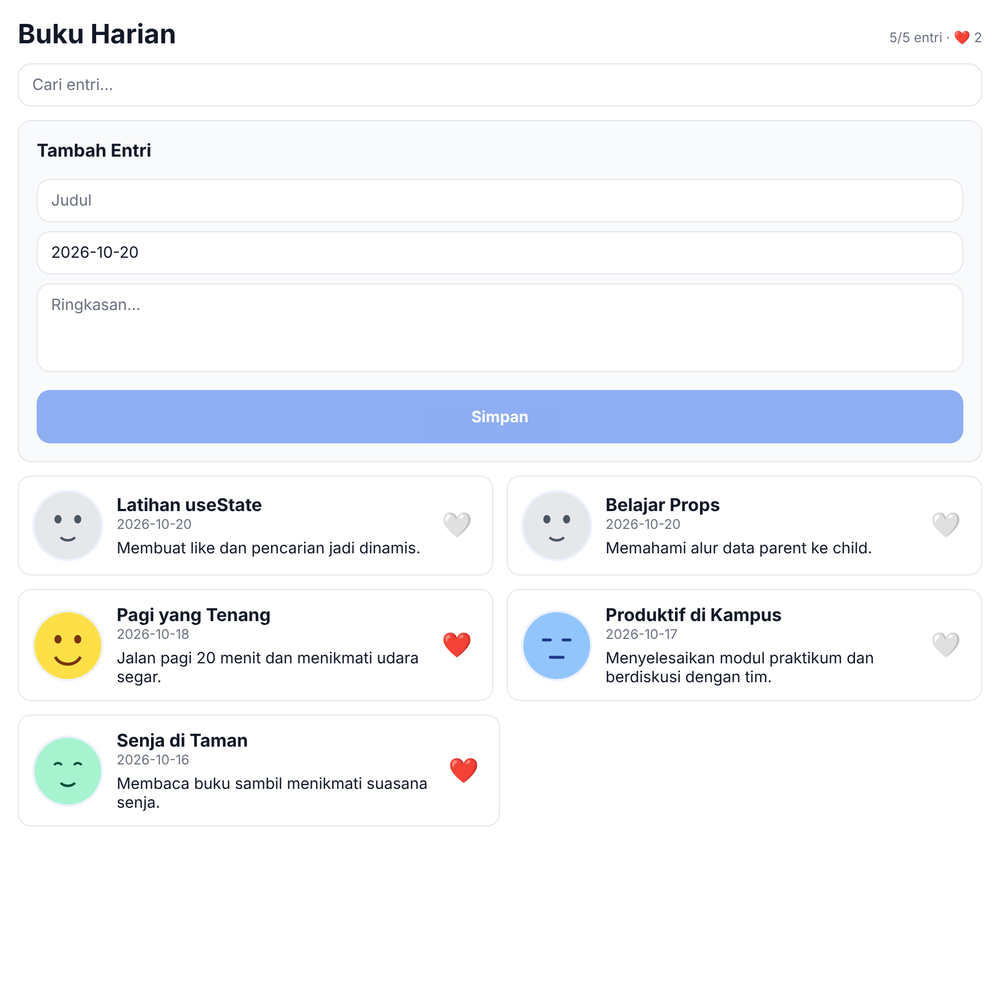

# Diary App: Praktikum Pertemuan 4

Props dan State pada React Native (Expo). Lanjutan dari Praktikum Pertemuan 3.

| | |
|---|---|
| **Nama** | Abyan |
| **NIM** | 2430511014 |
| **Mata Kuliah** | Mobile Programming, Program Studi Teknik Informatika, UMMI |
| **Repositori** | https://github.com/abyanalfairus-blip/diary-app |

## Cara Menjalankan

```bash
npm install
npx expo start        # tambahkan -c jika perlu membersihkan cache
```

Setelah server berjalan: tekan `a` (Android Emulator), `w` (web), atau scan QR dengan Expo Go.

## Fitur Pertemuan 4

- [x] **DiaryCard** sebagai presentational component: menerima data dan callback lewat props, tanpa `useState`.
- [x] **SearchBar**: local state `queryText` dan callback `onChange` ke parent.
- [x] **EntryForm**: controlled form (judul, tanggal, ringkasan) dan callback `onSubmit`. Tombol Simpan nonaktif selama judul/ringkasan kosong, dan form dikosongkan setelah disimpan.
- [x] **DiaryListScreen** sebagai container: mengelola `entries`, `query`, `likedIds`, dan `selected`.
- [x] **Derived state**: `filtered` (hasil pencarian, `useMemo`) dan jumlah entri yang disukai.
- [x] **Like** berubah tanpa reload, memakai `Set` baru setiap kali.
- [x] **Modal detail** dibuka dan ditutup lewat state `selected`.
- [x] **Gambar lokal** di `assets/moods/` (`happy.png`, `focus.png`, `calm.png`, `default.png`), tanpa koneksi internet.
- [x] Layout responsif dari Pertemuan 3 tetap ada: 1 kolom di ponsel, 2 kolom saat lebar >= 600 px.

## Struktur Proyek

```
diary-app/
├── App.js
├── assets/
│   └── moods/            happy.png, focus.png, calm.png, default.png
├── screenshots/          bukti pengujian
└── src/
    ├── components/
    │   ├── DiaryCard.js
    │   ├── DiaryDetailModal.js
    │   ├── SearchBar.js
    │   └── EntryForm.js
    ├── screens/
    │   └── DiaryListScreen.js
    └── styles/
        └── tokens.js
```

## Penjelasan Props dan State

**Props** adalah data atau fungsi yang dikirim parent ke child. Child hanya membaca props, tidak mengubahnya.
**State** adalah data milik komponen yang bisa berubah lewat setter dari `useState`. Setiap kali state berubah, React merender ulang tampilan.

Analogi: `DiaryListScreen` seperti **bagian administrasi kampus** yang memegang buku induk (state). `DiaryCard` seperti **papan pengumuman**: hanya menampilkan apa yang ditempel administrasi (props). Kalau mahasiswa ingin menandai sesuatu (like), ia tidak mencoret papan sendiri, melainkan **melapor ke administrasi** (callback `onToggleLike`). Administrasi memperbarui buku induk, lalu papan diperbarui.

### Aliran data

```
DiaryListScreen (PARENT / CONTAINER)
├── props data ─────> DiaryCard     title, date, preview, moodImage, liked
├── callback  <────── DiaryCard     onToggleLike(), onPress()
├── callback  <────── SearchBar     onChange(text)
└── callback  <────── EntryForm     onSubmit(entry)

Aksi pengguna → callback dipanggil → setState() di parent → state berubah → re-render → UI terbaru
```

### Jenis state yang dipakai

| State / Nilai | Jenis | Letak | Peran |
|---|---|---|---|
| `entries` | State utama (shared) | DiaryListScreen | Seluruh data diary |
| `query` | State utama (shared) | DiaryListScreen | Kata kunci dari SearchBar |
| `likedIds` | State utama (shared) | DiaryListScreen | `Set` berisi id entri yang disukai |
| `selected` | State utama | DiaryListScreen | Entri yang sedang dibuka di modal |
| `filtered` | Derived state | DiaryListScreen | Dihitung dari `entries` + `query` dengan `useMemo` |
| `queryText` | Local state | SearchBar | Isi kolom pencarian |
| `title`, `date`, `preview` | Local state | EntryForm | Isi input form (controlled) |

### Kenapa `Set` harus dibuat baru?

React membandingkan referensi. Jika `Set` lama diubah langsung, referensinya sama, sehingga React tidak mendeteksi perubahan. Karena itu selalu dibuat salinan baru:

```js
setLikedIds((prev) => {
  const next = new Set(prev);
  next.has(id) ? next.delete(id) : next.add(id);
  return next;
});
```

Prinsip yang sama dipakai saat menambah entri: `setEntries((prev) => [newEntry, ...prev])`, bukan `entries.push(...)`.

## Screenshot Pengujian

| Sebelum (awal) | Pencarian "kampus" | Like 2 entri |
|---|---|---|
|  |  |  |

| Modal detail | Form diisi | Sesudah: 2 entri baru |
|---|---|---|
|  |  |  |

**Layar lebar (>= 600 px, 2 kolom)**



## Checklist Pengujian

- [x] Project dapat dijalankan dengan `npx expo start`.
- [x] DiaryCard menerima data melalui props.
- [x] `liked` dan `onToggleLike` dikendalikan oleh parent.
- [x] SearchBar memiliki local state dan mengirim perubahan melalui `onChange`.
- [x] EntryForm menggunakan controlled inputs.
- [x] EntryForm mengirim data baru melalui `onSubmit`.
- [x] `entries` bertambah setelah form disimpan (diuji dengan 2 entri baru).
- [x] `query` memfilter daftar tanpa mengubah data asli.
- [x] `likedIds` berubah menggunakan `Set` baru.
- [x] `selected` membuka dan menutup DiaryDetailModal.
- [x] Tidak ada error import atau warning utama di terminal.
